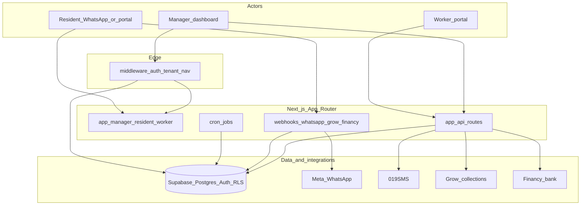

# BINO — System architecture

Canonical map for humans and agents. Read this in ~10 minutes before changing structure or hot paths.

**Product differentiation:** Building Intelligence & Operations — operational memory per building, not generic ticket CRUD. Rules: `.cursor/rules/bino-product-differentiation.mdc`.

**Related live docs:** [DOMAIN](./DOMAIN.md) · [PAYMENTS](./PAYMENTS.md) · [AUTH_MIDDLEWARE_SAFETY](./AUTH_MIDDLEWARE_SAFETY.md) · [RUNBOOKS](./RUNBOOKS.md) · [AGENT_MANDATORY_CHECKLIST](./AGENT_MANDATORY_CHECKLIST.md) · [LIB_LAYOUT](./LIB_LAYOUT.md)

---

## System diagram

| Surface | Entry | Auth |
|---------|-------|------|
| Manager | `app/(manager)/*`, `/login` | Supabase session + middleware tenant |
| Resident report | `/report`, WhatsApp QR | Public / Meta webhook |
| Resident portal | `/resident/*` | Resident membership |
| Worker | `/worker`, `/worker-login` | Worker token / session |
| Superadmin | `/superadmin/*` | Admin secret + MFA gates |
| Webhooks | `/api/webhook/*` | Meta signature / Grow token |
| Cron | `/api/cron/*` | `CRON_SECRET` |

Canonical user origin: `https://bino.casa`. Agent smoke alias: `https://bamakor.vercel.app` ([DOMAIN.md](./DOMAIN.md)).

---

## Domains → code

| Domain | `lib/` | Typical `app/api/` |
|--------|--------|-------------------|
| WhatsApp outbound / inbox helpers | `lib/whatsapp/` | `app/api/whatsapp/*` |
| WhatsApp inbound webhook | `lib/whatsapp-webhook/` (`dispatch-inbound`, `inbound-media`, `inbound-session`) | `app/api/webhook/whatsapp` |
| Tickets | `lib/tickets/` | `create-ticket`, `close-ticket`, … |
| Collections / VaadPay | `lib/collections/` | `app/api/collections/*` |
| Payments (Grow / iCount) | `lib/payments/` | Grow webhooks, settings |
| Bank / Financy | `lib/bank/`, `lib/bank-match/` | `app/api/building-finance/bank*`, `bank-match` |
| Building finance | `lib/building-finance/` | `app/api/building-finance/*` |
| Building governance | `lib/building-governance/` | `app/api/building-governance/*` |
| Residents / portal | `lib/residents/`, `lib/resident-portal/` | `app/api/resident/*` |
| Attendance | `lib/attendance/`, `lib/nfc/` | `app/api/worker/attendance/*`, NFC |
| Maintenance tasks | `lib/maintenance/` | `app/api/maintenance-tasks/*` |
| Worker portal | `lib/worker/` | `app/api/worker/*` |
| Recommendations / ops memory | `lib/recommendations/`, `lib/ops/`, `lib/ops-context/` | `app/api/recommendations/*` |
| PalGate parking pilot | `lib/palgate/` | `app/api/parking/*` |
| Tenant resolution | `lib/tenant/` | used by middleware + APIs |
| API session helpers | `lib/auth-api/` | every protected route |
| Shared utilities | `lib/shared/` | cross-cutting |

Full folder map: [LIB_LAYOUT.md](./LIB_LAYOUT.md). **Cross-cutting at root:** `database.types.ts`, `api-body-schemas.ts`, `supabase.ts`, `supabase-admin.ts` (~80 files hygiene target).

---

## Security rules (non-negotiable)

1. **Browser** (`lib/supabase.ts`): reads only. Never write `clients` / org admin tables from the client (RLS silent no-op).
2. **Server writes:** `getSupabaseAdmin()` in API routes only.
3. **Protected API order:** `requireSessionClientId` / Lite → rate limit → Zod (`api-body-schemas`) → business logic.
4. **Middleware tenant chain** must use **service role** (`getSupabaseAdmin` + `listClientIdsForUserId`) — never session JWT for `clients` / org chain. See [AUTH_MIDDLEWARE_SAFETY.md](./AUTH_MIDDLEWARE_SAFETY.md).
5. Do not filter `clients` columns under `authenticated` unless column GRANTs exist (`078` / `116`+).

---

## Critical flows

### WhatsApp → ticket

1. `POST /api/webhook/whatsapp` verifies Meta signature.
2. Tenant resolve by `whatsapp_phone_number_id` (`lib/tenant-resolution` / tenant module).
3. `lib/whatsapp-webhook` parses inbound → `runWhatsAppInboundBackground`.
4. Session / project selection / ticket create; optional AI intake (`whatsapp-ai*`).
5. Outbound via `lib/whatsapp` send/templates; SMS via `lib/sms*` when toggles require it.

### Grow collection charge

1. Manager / portal creates charge (`lib/collections`, Grow client in `lib/payments`).
2. Resident pays via Grow link (`/vaad-pay`, `/pay`).
3. Webhook updates charge status; optional invoice / receipt email.

### Manager login → tenant

1. Google/session via Supabase Auth.
2. Middleware resolves user → client IDs (admin client) → nav feature gates.
3. Pages load tenant-scoped data; writes go through `/api/*`.

---

## North-star metrics (where in code)

| Metric | Intent | Code pointers |
|--------|--------|----------------|
| זמן עד שיוך | Time to assignment | `lib/recommendations`, ticket assign paths |
| זמן עד פתרון | Time to resolution | summary / ops digest |
| שיעור תקלות חוזרות | Recurring failures | recommendations detectors |
| עלות תחזוקה לבניין | Cost per building | `building-finance`, maintenance cost helpers |
| % ללא התערבות מנהל | Automation rate | recommendations, worker suggest, WA intake |

Ops briefing / LLM context: `lib/ops-context/`.

---

## Organization waves (deluxe cleanup)

Zero behavior change. Moves use **compat shims** at old paths (`export * from './<domain>/…'`). Details: [LIB_LAYOUT.md](./LIB_LAYOUT.md).

1. Docs map + archive (this file + `docs/archive/`)
2. Domain folds: whatsapp → attendance → maintenance → collections → payments → worker → tenant/auth-api → shared
3. God-file extracts: `dispatch-inbound`, tickets-client, WhatsApp inbox, dashboard
4. Shim deletion after imports updated + CI green

**Never** combine middleware/tenant/auth logic edits with file-move PRs.
