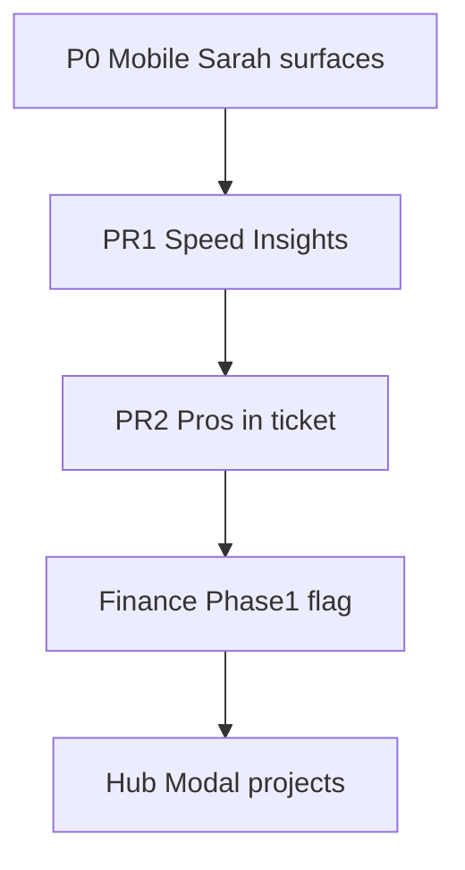

# BINO — שיפור לפי שימוש לקוח (שרה / Bamakor)

**מקור:** קנבס מחקר `sarah-bamakor-mobile-usage` + `feature_page_views` (30 יום) + Vercel Analytics מובייל ישראל  
**תאריך:** 16.11.2026  
**עקרון:** משפרים קודם את מה שהלקוח המשלם **נוגע בו כל יום בטלפון**, במיוחד בחלון הערב.

---

## 1. מה שרה נגעה בו הכי הרבה (30 יום)

| מסך | צפיות | מסקנה למוצר |
|------|--------|-------------|
| **לוח בקרה** | **219** | מסך הבית התפעולי — חייב להיות מהיר ויציב במובייל |
| **תקלות** | **127** | זרימת עבודה עיקרית — כרטיס תקלה + שיוך חייבים מובייל־ראשון |
| **WhatsApp Inbox** | **43** | ערוץ תפעול חי — צ׳אט לא יכול להיות “דסקטופ שבור” בטלפון |
| פרויקטים | 33 | חשוב — לב הפרויקט/Hub חשוב ל־2.0, אבל **אחרי** דשבורד/תקלות/WA |
| עובדים | 31 | בינוני |
| דיירים | 28 | בינוני |

**שיא שימוש:** **18:00–19:00** שעון ישראל — חלון טלפון (אחרי יום עבודה / סיבוב שטח).

---

## 2. מובייל ישראל (כל האתר) — Vercel Analytics

| דירוג | נתיב | קהל | הערה |
|-------|------|------|------|
| 1 | `/intake` | דיירים | חייב להישאר מהיר (אל תשבור ב־P0 Finance) |
| 2 | `/worker` | עובדי שטח | Speed Insights הכי חלש — P0 skeleton/CLS |
| 3 | `/tickets` + `/dashboard` | מנהלת מהנייד | חופף לשימוש שרה — עדיפות עליונה |

**מגבלת נתונים:** ב־`feature_page_views` **אין device**. פיצול מובייל/דסקטופ מגיע מ־Vercel Analytics לישראל.  
**שיפור מדידה (אופציונלי בהמשך):** להוסיף `viewport` / `device_class` ל־page-view (בלי PII) כדי לאחד מקורות.

---

## 3. איך משפרים את המערכת בהתאם

### P0 — מה שרה חיה עליו בטלפון (לפני Finance כבד)

| משטח | שיפור | קישור לתוכניות |
|--------|--------|----------------|
| `/dashboard` | LCP/CLS, shell יציב, KPI שלא קופצים | PR1 Speed Insights |
| `/tickets` | כרטיס תקלה **מלא־מסך** במובייל (לא drawer צר), פעולות אגודל | PR1 + הרחבת TicketDetail UX |
| WhatsApp Inbox | צ׳אט **מובייל־ראשון** (רשימה → שיחה מלאה) | P0 מובייל מנהלת |
| `/worker` | skeleton יציב, בלי loader שמוחק hero | PR1 Speed Insights |
| חלון 18:00–19:00 | כל מסך P0 חייב לעבוד ביד אחת, מהיר על 4G | קריטריון קבלה |

**לא ב־P0:** מסכי Finance מלאים, Hub בניין עשיר, scrapers — אלה אחרי שהטלפון של שרה יציב.

### P1 — פחות כניסות חוזרות, יותר החלטות במקום

| שיפור | למה לפי נתונים |
|--------|----------------|
| **Bottom nav** מותאם לערב (דשבורד / תקלות / WhatsApp / עוד) | 219+127+43 צפיות — ניווט מהיר בלי חיפוש בתפריט |
| **Push / badge** במקום ריענון דשבורד | מפחית כניסות חוזרות ל־219 צפיות “לבדוק מה חדש” |
| **המלצת עובד / איש מקצוע בתוך התקלה** | מקצר זמן שיוך בזרימה #2; מתחבר ל־PR2 Pros rating |
| Palette V2 על משטחי P0 | עקביות ויזואלית בלי לשבור Marketing |

### P2 — דיירים וקישורים עמוקים

| שיפור | למה |
|--------|-----|
| לשמור `/intake` מהיר | #1 מובייל ישראל — אל תעמיס |
| לינק עמוק דייר → תקלה | סוגר לולאה בין פורטל/סקר לטיפול |
| Hub ממורכז לפרויקטים | שימוש נמוך יותר אצל שרה — אחרי P0/P1 מובייל |

---

## 4. השלכה על סדר 2.0 (Finance + Ops)

1. **קודם טלפון של שרה** (דשבורד, תקלות, WA, worker) — זה ה־ROI היומי של הלקוח המשלם.  
2. **PR2 Pros** מזין שיוך מתוך כרטיס תקלה (P1).  
3. **Finance / Hub** נכנסים אחרי שהמסכים החמים יציבים — אחרת מוסיפים עומס למובייל שבקושי נושמת.  
4. **פרויקטים (33)** — BuildingHubModal חשוב ל־2.0, אבל לא לפני תיקון חוויית תקלות/דשבורד בטלפון.

---

## 5. קריטריוני קבלה ממוקדי־לקוח

- [ ] דשבורד + תקלות + WA Inbox + worker: אין CLS בולט / skeleton יציב במובייל ≤768px  
- [ ] כרטיס תקלה במובייל: מלא־מסך, פעולות עיקריות נגישות באגודל  
- [ ] בדיקה ידנית/דמו בחלון **18:00–19:00** על מכשיר אמיתי או emulation + 4G  
- [ ] Bamakor smoke + runtime errors אחרי deploy  
- [ ] `/intake` לא נפגע בזמן (LCP לא מחמיר)

---

## 6. North-star

| מדד | איך השימוש של שרה מקדם |
|------|-------------------------|
| זמן עד שיוך | תקלות מובייל + המלצת עובד/מקצוען בכרטיס |
| % בלי התערבות מנהל | Pros memory + המלצות בתוך הזרימה החמה |
| עלות לבניין | Finance אחרי שהתפעול היומי בטלפון יציב — לא במקומו |
