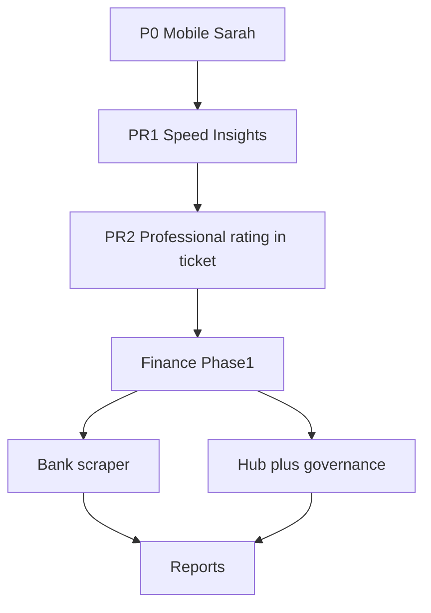

# BINO 2.0 — המלצות ארכיטקט: איך לבנות בלי לשבור

**תאריך:** 16.11.2026  
**הקשר:** אישור הנהלה התקבל; סדר ביצוע נעול ב־[`BINO_FINANCE_ROADMAP.md`](./BINO_FINANCE_ROADMAP.md). זה מדריך בטיחות ל־Cursor / צוות.  
**North-star:** עלות תחזוקה לבניין + הוכחת חיסכון + זיכרון תפעולי (ספקים/החלטות/כסף).

---

## 0. WhatsApp — שרה מול לקוחות חדשים

| | שרה / Bamakor | לקוחות BINO הבאים |
|--|---------------|-------------------|
| שיחה נכנסת | תבניות + flow קיים | **AI chatbot** (opt-in) |
| חיבור מספר | `whatsapp_phone_number_id` שלה | מספר/Phone Number ID **שלהם** per-tenant |
| הפעלה | בלי `client_whatsapp_ai_chat.enabled` | שורה `enabled=true` + `WHATSAPP_AI_CHAT_ENABLED` |

לא להעביר את שרה ל־AI באותו deploy שמפעיל לקוח חדש — השער ב־[`lib/whatsapp-ai-chat/gate.ts`](../../lib/whatsapp-ai-chat/gate.ts).

---

## 1. עקרון על — “מסילה קיימת לא נשברת”

BINO כבר חיה על **Grow + כרטסת + middleware service-role**. כל פיצ׳ר חדש חייב:

| כלל | למה |
|-----|-----|
| **PR קטן ומבודד** | לא לערבב Finance עם middleware/auth/tenant |
| **Feature flag / paid addon** | השקה מדורגת; כיבוי מיידי אם יש רגרסיה |
| **Append-only לכסף** | תיקון = זיכוי/ביטול, לא UPDATE על סכום שאושר |
| **שכבות Provider** | `PaymentProvider` (Grow), `BankDataProvider` (scrapers → AIS) — הדוחות לא מדברים ישירות עם ספק חיצוני |
| **Bamakor smoke + runtime errors** אחרי כל deploy שנוגע ל־runtime | מניעת נעילת לקוחות |
| **בלי Supabase preview branches** | עלות; מיגרציות רק אחרי review → prod / local |

**אסור באותו PR עם Finance:** שינוי `middleware.ts`, `lib/tenant-resolution.ts`, GRANTs על `clients`, או החלפת session-JWT ל־tenant.

---

## 2. סדר בנייה מומלץ (בטיחות לפני היקף)

**מצפן לקוח:** שרה/Bamakor — דשבורד 219, תקלות 127, WA 43; שיא 18:00–19:00 בטלפון.  
פירוט: [`BINO_BAMAKOR_MOBILE_USAGE_PRIORITIES_HE.md`](./BINO_BAMAKOR_MOBILE_USAGE_PRIORITIES_HE.md).

1. **קודם P0 מובייל שרה** — דשבורד, תקלות (כרטיס מלא־מסך), WA Inbox, worker — לא Finance לפני זה.  
2. **PR1 Perf** — CLS/LCP שמשרת את אותם מסכים.  
3. **PR2 Pros בתוך תקלה** — מקצר זמן שיוך בזרימה החמה.  
4. **Finance ליבה** אחרי שהטלפון יציב.  
5. **Hub פרויקטים** אחרי P0 (אצל שרה פרויקטים רק 33).  
6. **בנק + דוחות** אחרי שיש ספרים.

---

## 3. איך לא לשבור את מה שכבר עובד

### 3.1 Grow / גבייה
- **לא** לשנות סדר Approve → mark paid ב־`app/api/webhook/grow`.
- **לא** לשנות פורמט `idempotency_key` בכרטסת / charges.
- הרחבות: קריאה בלבד לסיכומים; התאמת בנק **לא** מסמנת `paid` רק בגלל סכום דומה.
- שכבת `PaymentProvider`: impl יחיד `GrowPaymentProvider` בהתחלה — בלי abstraction מיותר בקוד UI.

### 3.2 `unit_ledger_entries`
- נשארת **כרטסת AR ליחידה** (חיובים מדיירים).
- הוצאות בניין = טבלאות **נפרדות** (`building_expenses` וכו׳) — לא לדחוף הוצאות ניקיון לתוך ledger דירה.
- סנכרון ledger↔charges נשאר best-effort עם מפתחות קיימים.

### 3.3 מסמכים
- להרחיב `project_documents.visibility` — לא bucket ציבורי.
- עין ב־UI = כפתור ל־API שמעדכן ACL; בדיקה תמיד בשרת + signed URL.

### 3.4 בנק (scrapers)
- Worker נפרד (לא Vercel Function ארוך עם Puppeteer בלי תשתית).
- Credentials מוצפנים; feature flag; 1–2 בנייני פיילוט.
- טבלת `bank_transactions` פנימית = מקור לדוחות; החלפה ל־AIS בהמשך בלי UI חדש.

---

## 4. נקודת המבט שלי — מה לבנות קודם ומה אופציונלי

### חובה ל־MVP Finance (אחרי אישור)
1. מרכז פיננסי לבניין (KPI בסיסי מספריים)  
2. הוצאות + קטגוריות + אסמכתא  
3. תקציב שנתי מול ביצוע  
4. כרטסת יחידה (שיפור UX על הקיים)  
5. עין למסמכים + מסך “אמא של הבניין” מינימלי (פרטים + ועד + קישור לכספים)

### מומלץ מיד אחרי (ערך גבוה / סיכון בינוני)
6. פיילוט בנק scrapers → יתרה במרכז הפיננסי  
7. קישור חתימה/החלטה עם **רוב**  
8. דוח PDF רבעוני אחד מעוצב (תבנית אחת, לא 8 סוגי דוחות בבת אחת)

### אופציות פיצ׳ר (לא חוסמות MVP — לאשר בנפרד)
| פיצ׳ר | למה לשקול | סיכון |
|--------|------------|--------|
| הוצאה משותפת לכמה בניינים + מפתח חלוקה | לקוחות עם תיק גדול | מורכבות הנה״ח |
| חיוב חוזר אוטומטי לפי תקציב | חיסכון זמן גבייה | כפילויות מול Grow |
| דוח רואה חשבון (CSV/Excel סגור) | מכירה לחברות ניהול | דרישות פורמט משתנות |
| התראת חריגת תקציב ב־WhatsApp למנהל | פרואקטיביות | רעש / אנטי־ספאם |
| Statement דייר לפורטל (יתרה + היסטוריה) | שקיפות | ACL פיננסי אישי |
| קישור הוצאה↔תקלה/ספק מדורג | חיבור ops↔כסף | תלוי PR2 Pros |
| Snapshot חודשי אוטומטי בנוסף לרבעון | הרגל דיווח | עומס cron |

**המלצה:** לא לכלול את האופציות ב־Phase 1. לרשום כ־backlog אחרי שיש מרכז פיננסי חי אצל הלקוח מהפגישה.

---

## 5. דפוס מימוש טכני מומלץ

### API
סדר קבוע ב־BINO (לא לשבור):
1. `requireSessionClientId` / paid addon  
2. rate limit  
3. zod body  
4. `getSupabaseAdmin()` + בדיקת `project_id` שייך ל־client  

### כסף
- להמשיך `numeric(12,2)` + `roundMoney` הקיים ב־`lib/unit-ledger.ts`.  
- אופציונלי: `dinero.js` (MIT) רק אם מתחילים המרות מטבע / הקצאות מורכבות — **לא חובה ל־ILS בלבד**.

### UI
- Simple Outside: מסך בניין אחד → כרטיסי KPI → drill-down.  
- למחזר ExcelJS הקיים; PDF מ־**OPC** (`@react-pdf/renderer` + ערכת צבעים עברית).  
- גרפים: **Recharts** (קל ל־React) או ECharts — Integrate ב־Phase 3 בלבד.

### Color Palette V2 (Manager) — מערכתי
מסמך: [`BINO_COLOR_PALETTE_V2.md`](./BINO_COLOR_PALETTE_V2.md).

- להרחיב [`theme.ts`](../../app/components/ui/theme.ts) + [`globals.css`](../../app/globals.css) לכל הטוקנים (sidebar states, charts, payment, buttons).  
- רכיבים חדשים (Finance, Hub) — **רק** `theme.colors.*` / CSS vars.  
- Marketing נשאר ב־`marketing.css` — לא לזהם AppShell.  
- תזמון: **PR 1b** מוקדם כדי לא לצבוע מחדש מסכי Finance אחרי הכתיבה.

### לב הפרויקט — מודאל ממורכז (לא drawer מהצד)
**מצב היום:** `Drawer` ב־`app/components/ui.tsx` נפתח מ־`/projects` כ־slide-over ימין 560px (`detailDrawerOpen`) — צר מדי ל־Finance/ועד/מסמכים/חתימות.

**יעד:** `BuildingHubModal` — כרטיס מקצועי **במרכז המסך** (dim + blur, scale/fade), עם טאבים:
`סקירה | כספים | ועד | מסמכים | דיירים | החלטות | הגדרות`.

| כן | לא |
|----|-----|
| מודאל ממורכז רחב לדסקטופ; מובייל full-ish card | להשאיר slideInRight ל־“אמא של הבניין” |
| החלפת detail ב־`/projects` קודם | לשבור `TicketDetailDrawer` באותו PR |
| תוכן Finance/ועד נכנס לטאבים בתוך ה־Hub | לפזר עוד drawers צדדיים לכל מודול |

**תזמון:** Phase **1.5 Hub UI** לפני/בתחילת Phase 2 — כדי שכל השינויים ייכנסו למקום אחד יפה.

### חתימות
- MVP: טבלת `signature_requests` + token URL + canvas (`signature_pad` MIT) + ספירת **רוב**.  
- שליחה דרך WhatsApp/SMS/Resend הקיימים.  
- DocuSeal/OpenSign = sidecar אם הלקוח דורש PDF חתום “כבד”.

### בדיקות חובה לכל שלב
- Unit על חישובי כסף/רוב/תקציב  
- Route test ל־idempotency  
- E2E קל: יצירת הוצאה + הצגת יתרה  
- Bamakor smoke אחרי deploy  
- Runtime errors: אין `CLIENTS_ACTIVE_QUERY_FAILED` / spike 5xx

---

## 6. מיחזור מפרויקטים שלנו (GitHub)

| ריפו | מה לקחת | מה לא |
|------|---------|--------|
| **[YoniLevy10/OPC](https://github.com/YoniLevy10/OPC)** (`optical-center`) | דוחות PDF/Excel RTL, `formatIls`, סיכומי עלות, דירוג אנשי מקצוע (כ־inspiration; ב־BINO עמודות אמיתיות), הרשאות מסמכים לפי scope | memory-store / Midrag / encoding דירוג בתוך notes לטווח ארוך |
| **[YoniLevy10/Bino](https://github.com/YoniLevy10/Bino)** | Grow, ledger, collections UI, documents, excel-workbook | לשכתב גבייה מאפס |
| **[YoniLevy10/Moked](https://github.com/YoniLevy10/Moked)** | בידוד tenant + בדיקות isolation; דפוס PSP/webhook | להעתיק billing demo כהנה״ח בניין |
| **[YoniLevy10/Fixly](https://github.com/YoniLevy10/Fixly)** | feature flags תשלומים; idempotent webhooks | Stripe כתחליף Grow לגביית דיירים |

פירוט OSS חיצוני: [`BINO_OPEN_SOURCE_RESEARCH.md`](./BINO_OPEN_SOURCE_RESEARCH.md).

---

## 7. Definition of Done ל־Phase 1 (לפני שעוברים הלאה)

- [ ] הוצאה לבניין נשמרת עם קטגוריה ואסמכתא  
- [ ] תקציב מול ביצוע מוצג באחוזים  
- [ ] מרכז פיננסי מציג הכנסות גבייה (מ־charges) + הוצאות (חדש) בלי לשבור `/collections`  
- [ ] Feature flag / addon לכיבוי  
- [ ] אין שינוי middleware  
- [ ] Bamakor smoke ירוק + אין רגרסיית runtime  
- [ ] הלקוח מהפגישה יכול לעשות walkthrough על בניין אחד  

---

## 8. הוראה ל־Cursor (סדר נעול + מקביליות)

1. לשגר **כמה סוכנים** לפי [`BINO_PARALLEL_AGENTS_PLAYBOOK_HE.md`](./BINO_PARALLEL_AGENTS_PLAYBOOK_HE.md) — ענף + בעלות קבצים לכל סוכן.  
2. **Wave 1 במקביל:** Perf + Worker UX + Tickets mobile + Palette — בלי Finance.  
3. אחרי merge+smoke → Wave 2: Pros + Hub shell.  
4. Wave 3 במקביל מאחורי flags: Finance + Bank worker (+ Composio docs).  
5. לא לגעת ב־Grow/middleware; לא להתקין scrapers/PDF בלי PR ייעודי; לא לשבור `/intake`.  
6. כל טענה על קוד קיים — עם נתיב קובץ.  
7. אחרי כל deploy: Bamakor smoke + runtime errors.
