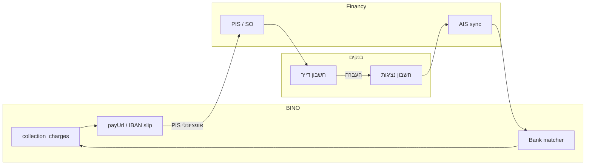

# Audit: גבייה בבנקאות פתוחה (Financy / Open Finance) — BINO

**תאריך:** 2026-11-17  
**היקף:** מחקר + ארכיטקטורה בלבד. **אין שינוי קוד / Production / ניתוק Grow.**  
**עיקרון:** BINO מנהלת דרישות, התאמות ושקיפות — הבנקים מחזיקים ומעבירים את הכסף.

---

## 1) המלצה (שורה אחת)

**כן לכיוון האסטרטגי** — להתחיל מ־**AIS + התאמת תנועות** (ערך מיידי, זול, בלי תלות בסליקה), אחר כך **קישורי PIS חד־פעמיים**, ורק אחרי אימות בנק־בבנק **הוראת קבע בנקאית**.  
**כרטיס אשראי נשאר משלים** (Grow הקיים / ספק אחר) — לא למחוק ולא לנתק.

---

## 2) מצב קיים ב־BINO (audit)

| שכבה | מה יש היום | פער מול המודל הרצוי |
|------|------------|---------------------|
| גבייה מדיירים | `collection_charges` + קישור `/pay` → **Grow** (S2S → `paid`) | ערוץ מרכזי = אשראי/סולק, לא בנק |
| Financy AIS | `lib/bank/*`, sync/cron, `bank_accounts` / `bank_transactions` | **client-wide** — לא per-building |
| Financy PIS | `createPayment` ב־Transfers (העברות **יוצאות** מחברת ניהול) | אין קישור תשלום לדייר → סימון `collection_charges.paid` |
| Financy ↔ גבייה | `collections-financy` = receivables / draft receipt בלבד | לא מחליף webhook תשלום |
| מסמכים | Grow invoice webhook / Financy drafts לאישור ב־UI שלהם | קבלה חוקית לוועד עדיין דורשת מסלול מסמכים נפרד |

מקורות פנימיים: `docs/PAYMENTS.md`, `docs/planning/BINO_FINANCY_CAPABILITY_MAP.md`, `lib/bank/financy-gateway.ts`.

---

## 3) יכולות Financy / Open Finance — מאומת מול תיעוד

מקורות: [Getting Started](https://docs-financy.open-finance.ai/docs/getting-started), [Create a Payment](https://docs-financy.open-finance.ai/docs/create-a-payment), [Connections](https://docs-financy.open-finance.ai/docs/connections), [Periodic Payment Init](https://docs.open-finance.ai/docs/periodic-payment-initialization), [תמחור](https://financy.open-finance.ai/).

| יכולת | זמין ב־API (מסלול paid)? | הערות קריטיות |
|--------|---------------------------|----------------|
| AIS — חשבונות / יתרות / תנועות | כן | אחרי חיבור בנק ב־**Financy UI בלבד** |
| רענון תנועות | כן | אוטומטי לפי תוכנית; refresh ידני ב־API |
| יצירת חיבור בנק ב־API | **לא** ב־Financy self-serve | «אין create connection ב־API». סקייל פרוגרמטי = **Open Finance B2B** (יצירת קשר) |
| PIS — `POST /v2/payments` + `payUrl` | כן | חובה: לפחות צד אחד (חייב/זוכה) הוא חשבון מחובר ב־Financy של אותו `userId` |
| Webhook סטטוס תשלום | כן (`callbackInformation`) | אצלנו כבר יש `/api/webhook/financy-payment` ל־PIS קיים |
| תשלום תקופתי / Standing order | **כן בתיעוד API** | דורש **אישור SCA חד־פעמי בבנק הדייר**; לא חיוב שקט מ־API בלי הסכמת בנק |
| ביטול הוראת קבע | כן (`DELETE /v2/payments/{id}`) | רק אחרי הרשאה |
| מגבלות בנק | כן | לדוגמה: לאומי דורש `endDate`; הפועלים — סכום > 9 |

### חיוב חוזר בלי אישור דייר בכל חודש?

| טענה | מאומת? |
|------|--------|
| API מחייב את חשבון הדייר כל חודש בלי שום הסכמה בבנק | **לא — אין הוכחה; לא נתמך כך** |
| דייר מאשר **פעם אחת** בבנק הוראת קבע (standing order), והבנק מבצע לפי תדירות | **כן בתיעוד** (`periodicPaymentInformation` + redirect ל־`scaOAuth`) |
| כל הבנקים בישראל תומכים באותו אופן | **לא מאומת** — יש כללי provider; חובה PoC לבנק־בבנק לפני הבטחה ללקוחות |

---

## 4) התאמה למודל «חשבון נציגות לכל בניין»

### זרימת כסף (PIS לדייר)

```
דייר → payUrl (Financy hosted) → מאשר בבנק שלו
     → העברה ל־IBAN נציגות הבניין (creditor)
BINO: webhook/poll → סימון collection_charges.paid
```

כסף **לא** עובר דרך BINO — עקבי לעיקרון.

תנאי: חשבון הנציגות מחובר כ־**creditor** תחת ה־Financy user שממנו יוצרים את ה־payment (בדרך כלל חשבון הניהול / הנציגות ב־Financy).

### עשרות חשבונות בניינים — צוואר בקבוק

| מגבלה | משמעות ל־BINO |
|-------|----------------|
| מכסת **חשבונות תאגיד (בע״מ)** | Free 3 / Starter 6 / Pro 10 / Ultra 30 / מעבר → **Enterprise** |
| חשבונות פרטיים / עוסק שאינו בע״מ | לפי Financy — **לא נספרים** במכסה (לוועד שאינו בע״מ זה יכול להקל; לאמת מולם לכל בניין) |
| חיבור בנק רק ב־UI | onboarding ידני לכל בניין ב־Financy Settings — לא סקייל API בלי B2B |
| BINO היום: `financy_*` על `clients` בלבד | חסר מודל **per-project** (בניין) ל־credentials / `connectionId` / IBAN זוכה |

**נדרש לפני סקייל:** שיחת B2B עם Open Finance על (א) Enterprise / white-label connections, (ב) האם נציגות בית משותף נספרת כתאגיד, (ג) תמיכה ב־PARTIALLY_AUTHORIZED (מספר מורשי חתימה).

---

## 5) עלויות משוערות (פומבי; לא הצעה חתומה)

| רכיב | אומדן |
|------|--------|
| מנוי Financy (לחשבון שמחזיק את חיבורי הבניינים) | Starter ₪49 / Pro ₪199 / Ultra ₪999 לחודש (+ מע״מ לפי מדיניותם) |
| עמלה על **PIS שהצליח** | Starter 0.4% (min ₪0.50); Pro 0.3% (min ₪0.50, max ₪3.50); Ultra 0.2% (min ₪0.50, max ₪2.70) |
| AIS בלבד (קריאה + התאמה) | בעיקר מנוי — **בלי** עמלה % על כל דייר |
| העברה ידנית מהדייר + התאמה ב־BINO | עלות ספק ≈ 0 לעסקה; עלות מוצר = פיתוח matching |
| השוואה לסליקה ~1.1%+ | PIS ב־Pro/Ultra לרוב **זול משמעותית** מעמלת אשראי; AIS+העברה ידנית זול עוד יותר |

דוגמה גסה: 80 דירות × ₪400 = ₪32,000/חודש בבניין אחד.  
עמלה Pro max ₪3.50 לעסקה → עד ~₪280 אם כולם ב־PIS; ב־AIS+העברה חופשית → ~₪0 עמלת ספק לעסקה.

---

## 6) ארכיטקטורה הדרגתית (מומלץ)

### שלב A — AIS per building + שקיפות (P0 מוצר)

1. חיבור חשבון נציגות ב־Financy UI (מורשה חתימה).  
2. ב־BINO: קישור בניין → `connectionId` / IBAN / תווית חשבון (הרחבת מודל מעבר ל־client-wide).  
3. Sync תנועות (cron הקיים + סינון לפי חשבון בניין).  
4. **אין** שינוי Grow.

### שלב B — התאמה אוטומטית (P0 גבייה בלי PIS)

1. דרישת תשלום חודשית נשארת ב־`collection_charges` (כמו היום).  
2. Matcher: סכום + תאריך + אסמכתא / שם / מספר דירה בתיאור.  
3. התאמה ודאית → `paid` + מקור `bank_match`; אי־ודאות → תור אישור ידני.  
4. Idempotency מול `bank_transactions.id` (מניעת כפילות).  
5. דייר יכול לשלם בהעברה רגילה (העתקת IBAN + אסמכתא מומלצת ב־SMS/WA) — **עובד בלי API לייזום תשלום**.

### שלב C — קישור PIS חד־פעמי (P1)

1. `POST /v2/payments` עם creditor = IBAN הנציגות, `externalId` = `charge_id`.  
2. שליחת `payUrl` ב־WhatsApp / אזור אישי (אותו UX כמו `/pay`).  
3. Webhook → `paid` (מקביל ל־Grow; דגל ספק per charge / per client).  
4. Grow נשאר ללקוחות/חיובים קיימים ול־fallback אשראי.

### שלב D — הוראת קבע בנקאית (P2 — רק אחרי PoC בנקים)

1. `periodicPaymentInformation` + SCA חד־פעמי.  
2. מעקב ביצועים חודשיים דרך AIS + סטטוס תשלום.  
3. לא להבטיח «בלי אישור אף פעם» — רק «אישור בנק חד־פעמי להוראת קבע».

### שלב E — אשראי משלים

Grow (או SUMIT וכו׳) כאופציה לדייר בלי בנקאות פתוחה / תייר / כישלון PIS — **לא תלות מרכזית**.



---

## 7) אבטחה, הרשאות, כפילויות

| נושא | המלצה |
|------|--------|
| כסף | לא לעבור דרך BINO; רק metadata + webhooks |
| Credentials | `financy_*` רק בשרת / admin; לא בדפדפן |
| Consent AIS | מעקב `expiryDate`; התראת חידוש למורשה חתימה |
| מורשים מרובים | לצפות ל־`PARTIALLY_AUTHORIZED`; UX «ממתין לאישור נוסף» |
| כפילויות | מפתח ייחודי: `bank_transaction_id` ↔ charge; לא לסמן paid פעמיים |
| PII | ת״ז (`psuId`) רק כשהבנק דורש; לא בלוגים גולמיים |
| Production | dual-run עם Grow; כיבוי Grow רק אחרי אחוז הצלחה מוכח |

---

## 8) סיכונים

| סיכון | חומרה | מיתון |
|-------|--------|--------|
| תלות ב־onboarding ידני לחיבור בנק | גבוהה בסקייל | Enterprise B2B / תפעול מונחה |
| מכסת חשבונות תאגיד | בינונית–גבוהה | סיווג משפטי של נציגות + Ultra/Enterprise |
| Standing order לא אחיד בין בנקים | גבוהה ל־P2 | PoC לאומי/הפועלים/דיסקונט לפני GA |
| Matching שגוי בהעברה חופשית | בינונית | אסמכתא חובה + תור ידני |
| Consent פג → אין AIS | בינונית | התראות + מחזור חיבור |
| בלבול עם Grow | נמוכה אם דגלים ברורים | `collections_payment_rail` per charge |

---

## 9) תוכנית מימוש (בלי קוד בשלב זה)

| שלב | תוצר | תלות חיצונית | נגיעה ב־Grow |
|-----|------|----------------|-------------|
| 0 | מסמך זה + אישור בעלים | — | אין |
| 1 | שיחת Open Finance: B2B connections, מכסות נציגות, multi-signatory | פגישת מכירות/שותפים | אין |
| 2 | PoC AIS: בניין אחד, sync, UI יתרה/תנועות | Financy paid + חיבור בנק | אין |
| 3 | Matcher MVP + תור ידני + העברה עם אסמכתא | — | אין ניתוק |
| 4 | PoC PIS: charge אחד → payUrl → webhook → paid | עמלה לפי תוכנית | dual-run |
| 5 | PoC standing order ב־2 בנקים | אימות provider rules | אין |
| 6 | החלטת GA: בנק ראשי / אשראי משלים | מדדי הצלחה | Grow נשאר ל־fallback |

**קריטריון הצלחה מוצע ל־GA בנק כערוץ ראשי:** ≥70% מהחיובים בבניין פיילוט נסגרים ב־AIS-match או PIS תוך 7 ימים, בלי רגרסיה ב־Grow ללקוחות קיימים.

---

## 10) מה לא לעשות עכשיו

- לא לנתק Grow / לא לבטל הרשאות פעילות / לא לשנות Production rails.  
- לא להבטיח ללקוחות «חיוב אוטומטי בלי אישור בנק».  
- לא לבנות Marketplace אשראי (SUMIT) כערוץ מרכזי במקביל בלי החלטת עדיפות — האשראי נשאר משלים.  
- לא להניח ש־Financy self-serve מספיק ל־50+ בניינים בלי Enterprise.

---

## 11) החלטות בעלים (נעול 2026-11-17)

1. **P0 = AIS-style matching via CSV-first** (לא PIS). מנוע התאמות + ייבוא + חשבון per-building.  
2. **Financy** = חשבון חברת הניהול בלבד (העברות). לא AIS לבניינים ב־P0.  
3. **Grow** נשאר; אין SUMIT במקביל.  
4. **Scrapers** = יעד לחשבונות ועד, מאחורי דגל + שער משפטי; ב־P0 רק stub.  
5. התאמה מדורגת A/B/C; תזכורות פער = כפתור מנהל (לא blast אוטו).

מימוש: `lib/bank-match/*`, migration `147_building_bank_match_p0.sql`, דגלים `BANK_MATCH_POC_ENABLED` / `BUILDING_BANK_SCRAPER_SYNC_ENABLED`.

### עדכון 2026-11-18 (W5)
מייל B2B ל־Open Finance (50–60 חשבונות) — **ממתין לתשובה**. אין שינוי מודל per-building עד תשובה. מעקב: `docs/VENDOR_INTEGRATIONS_TRACKER.md`.

---

## נספח א — שאלות קריטיות ל־Open Finance (B2B)

1. האם ניתן לחבר **חשבונות נציגות בית משותף** (לא בע״מ) במכסה נפרדת מחשבונות תאגיד?  
2. האם קיים / מתוכנן **API ליצירת Connection** (לא רק Financy UI) לפלטפורמת SaaS multi-tenant?  
3. איך ממודלים **עשרות חשבונות** תחת ארגון אחד של חברת ניהול vs user נפרד לכל בניין?  
4. תמיכה ב־**PARTIALLY_AUTHORIZED** / מספר מורשי חתימה על אותו חשבון נציגות?  
5. מחיר **Enterprise**: מנוי, עמלה ל־PIS, מגבלת connections, SLA.  
6. Webhook/consent expiry: התראות לחידוש הסכמה ברמת חשבון.  
7. האם PIS לדייר (creditor = חשבון נציגות מחובר) מאושר מסחרית במודל marketplace בלי שהכסף עובר דרך BINO?

---

## נספח ב — שדות העברה Financy (מאומת)

IBAN **לא חובה**. אפשר `creditorAccountType: "bban"` עם `XX-XXX-XXXXX` (בנק–סניף–חשבון) + `creditorName` + `amount` + `currency` + `description`.
