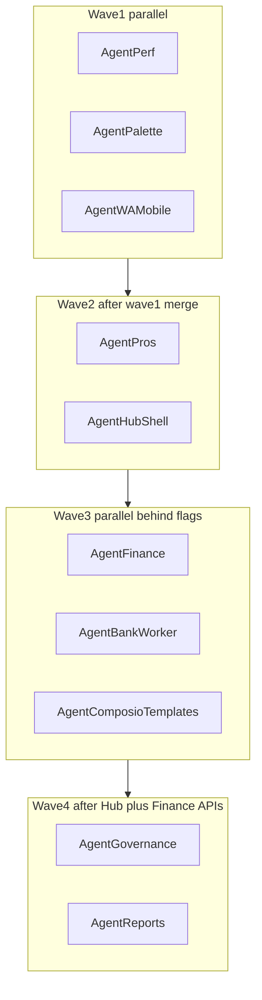

# BINO 2.0 — Playbook סוכנים במקביל (בלי לדרוס אחד את השני)

**עקרון:** כמה סוכני Cursor עובדים במקביל על **ענפים / אזורי קבצים נפרדים**, עם feature flags ומיזוג מסודר. אף סוכן לא נוגע ב־middleware/auth/Grow webhook אלא אם זה התפקיד היחיד שלו (ובדרך כלל — לא).

---

## 1. חוקי ברזל לכל הסוכנים

| כלל | פירוט |
|-----|--------|
| **ענף נפרד** | `cursor/p0-mobile-perf`, `cursor/palette-v2`, `cursor/pros-memory`, `cursor/finance-p1`, … |
| **בעלות קבצים** | טבלת ownership למטה — אסור לערוך קובץ של סוכן אחר בלי תיאום |
| **אסור לכולם** | `middleware.ts`, `lib/tenant-resolution.ts`, GRANTs על `clients`, סדר Grow Approve→paid, שינוי פורמט `idempotency_key` |
| **Flag** | כל גל מאחורי flag/addon; כבוי כברירת מחדל בפרוד |
| **PR קטן** | סוכן = PR אחד (או שניים מקסימום קשורים) |
| **אחרי merge** | Bamakor smoke + runtime errors; אין להתחיל גל תלוי לפני ירוק |
| **שרה** | לא להפעיל AI chat / scrapers / Finance UI עליה בלי flag מפורש |

---

## 2. מסלולי סוכנים מקבילים (גלים)

### Wave 1 — במקביל עכשיו (אחרי אישור ביצוע)

| סוכן | משימה | קבצים מותרים (עיקריים) | אסור |
|------|--------|-------------------------|------|
| **Agent-Perf** | Speed Insights: AppShell CLS, dashboard shell, Inter drop | `lib/use-is-mobile.ts`, `app/components/ui.tsx` (רק CLS/layout), `dashboard-shell.tsx`, `layout.tsx` fonts, `LegalPublicShell` | TicketDetailDrawer לוגיקה עסקית; WA inbox; Finance |
| **Agent-WorkerUX** | `/worker` skeleton יציב | `app/worker/**`, `WorkerTicketsScreen`, `page-skeleton` | AppShell כללי אם Perf עליו — תיאום / אחרי Perf |
| **Agent-TicketsMobile** | כרטיס תקלה מלא־מסך במובייל | `TicketDetailDrawer.tsx`, hooks ticket drawer, CSS מקומי | `ui.tsx` Drawer הגלובלי בזמן ש־Hub/Perf נוגעים בו — העדפה: שינוי מקומי בטיקט בלבד |
| **Agent-Palette** | Palette V2 tokens | `app/components/ui/theme.ts`, `app/globals.css` (tokens בלבד), מיפוי hex ברכיבים **רק** אחרי תיאום או ב־PR follow-up | Marketing CSS; שינוי לוגיקה |

> אם 4 סוכנים צפופים על `ui.tsx`: **Perf קודם** על AppShell; Tickets לא משנים את `Drawer` הגלובלי באותו רגע — רק התנהגות מובייל בתוך TicketDetail.

### Wave 2 — אחרי merge של Wave 1

| סוכן | משימה | קבצים |
|------|--------|--------|
| **Agent-Pros** | דירוג/use_count + העברה בתקלה | migration professionals, `lib/hooks/use-professionals*`, `ForwardToProfessionalBlock`, APIs professionals |
| **Agent-HubShell** | `BuildingHubModal` מעטפת ריקה + טאבים | קומפוננטה חדשה תחת `app/components/projects/`, חיבור מ־`projects/page.tsx` בלבד — **לא** לשבור Ticket Drawer |

### Wave 3 — במקביל מאחורי flags (אחרי Wave 2 או חופף זהיר)

| סוכן | משימה | קבצים | תלות |
|------|--------|--------|------|
| **Agent-Finance** | הוצאות/תקציב/APIs/UI flag | `supabase/migrations/*finance*`, `lib/*expense*`, `app/api/*/finance*`, טאב כספים ב־Hub | לא לגעת ב־Grow webhook |
| **Agent-Bank** | scrapers worker + `bank_transactions` | `lib/bank/*`, worker/cron נפרד, migrations bank | לא לערבב עם Finance schema באותו קובץ migration |
| **Agent-ComposioMeta** | סנכרון תבניות Meta (Utility) דרך Composio | `docs/COMPOSIO_META_TEMPLATES.md`, `scripts/composio-sync-meta-templates.mjs`, `app/api/superadmin/meta-templates`, `MetaWhatsAppPendingPanel`; לא לשנות webhook פרוד | `COMPOSIO_API_KEY` + WABA מבעלים |

### Wave 4

| סוכן | משימה |
|------|--------|
| **Agent-Governance** | ועד, מסמכים+עין, חתימות רוב — בתוך Hub |
| **Agent-Reports** | PDF מ־OPC + רבעון — אחרי שיש נתוני כספים/בנק |

---

## 3. מניעת התנגשויות (merge)

1. **קובץ משותף חם** (`ui.tsx`, `globals.css`, `theme.ts`): בעלים יחיד לגל; אחרים מחכים או עובדים על קבצים חדשים.  
2. **Migrations:** מספר רץ ייחודי לכל סוכן — לתאם מספר migration לפני כתיבה (לא שני סוכנים על `130_*.sql`).  
3. **Types:** אחרי migration — סוכן אחד מריץ `db:types` או מעדכן ידנית ב־PR שלו בלבד.  
4. **rebase על main** לפני פתיחת PR; קונפליקט ב־`ui.tsx` → Perf/Palette מנצחים לפי סדר Wave.  
5. סוכן **לא** מתקין deps גלובליים בלי תיאום (`israeli-bank-scrapers`, `@react-pdf`) — רק ב־PR של Bank/Reports.

---

## 4. תיאום יומי (קצר)

בכל בוקר / לפני שיגור סוכנים:

- [ ] מי רץ עכשיו (שמות סוכנים + ענפים)  
- [ ] אילו קבצים נעולים  
- [ ] מה כבר merged ל־main  
- [ ] האם smoke Bamakor ירוק אחרי ה־merge האחרון  

---

## 5. מה אסור לעשות “במקביל”

- שני סוכנים על Grow webhook / collections mark-paid  
- שני סוכנים על middleware  
- Finance + Bank באותה migration  
- AI chat על Bamakor בזמן שסוכן אחר משנה תבניות של שרה  
- Push לכל הקבצים מ־main באמצע עבודת סוכן בלי rebase מכוון
